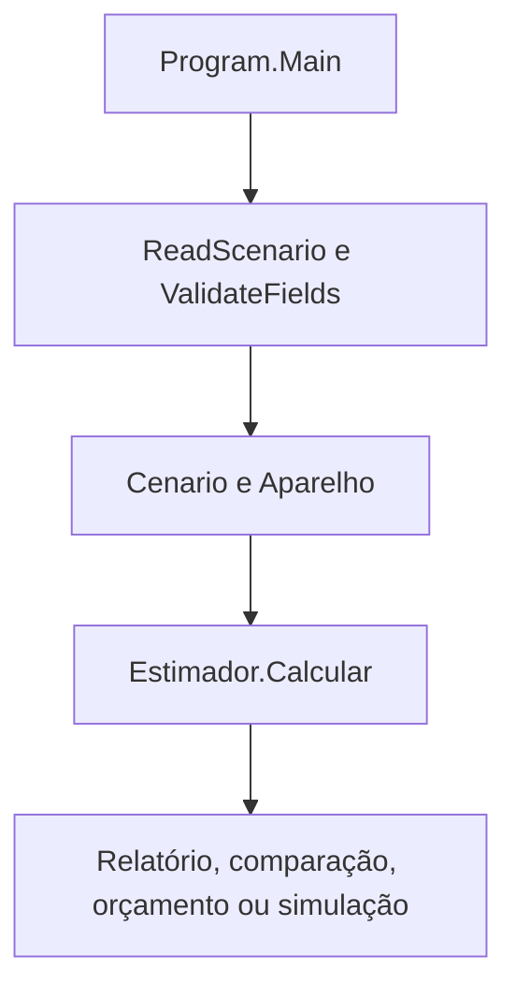

# Como o Consumo de Energia calcula suas estimativas

## Fluxo dos dados

O SDK .NET 8 compila uma aplicação de terminal. A entrada é um arquivo JSON do usuário. O programa usa `System.Text.Json`, publica o resultado em JSON na saída padrão e escreve os erros tratados na saída de erro com código 2. Os modos processam os dados em memória, e o cenário original permanece disponível para reutilização.

| Arquivo | Responsabilidade |
| --- | --- |
| [Program.cs](../src/ConsumoEnergia/Program.cs) | Despacha argumentos. Limita a leitura a 1.000.000 bytes, valida UTF-8 e rejeita chaves JSON duplicadas mesmo com diferença de caixa. Também abriga os modelos e o estimador. |
| [ComparadorCenarios.cs](../src/ConsumoEnergia/ComparadorCenarios.cs) | Estima os dois cenários e calcula diferenças por aparelho e no total. |
| [AnaliseOrcamento.cs](../src/ConsumoEnergia/AnaliseOrcamento.cs) | Compara um relatório já calculado com o limite mensal e lista os maiores custos. |
| [SimuladorHoras.cs](../src/ConsumoEnergia/SimuladorHoras.cs) | Cria um cenário derivado com novas horas de uso e delega a comparação. |

O modelo `Cenario` reúne tarifa por kWh e aparelhos. Cada `Aparelho` informa potência, horas por dia e dias de uso. `Estimador.Calcular` valida a tarifa de 0 a 1.000, exige entre 1 e 500 aparelhos e compara nomes aparados sem distinguir maiúsculas de minúsculas. Ele calcula kWh com `decimal`, arredonda o custo de cada aparelho para duas casas, com pontos médios afastados de zero, e soma os custos já arredondados. A tarifa vem do cenário informado. A integração com concessionárias e o armazenamento de cenários são possibilidades de evolução.

## Roteiro de estudo

1. Abra o [cenário de exemplo](../examples/cenario.json) e identifique cada campo no tipo `Aparelho`.
2. Siga `ReadScenario` até `Estimador.Calcular`. Em seguida, localize `SelfTest` e confira as expectativas para um ou vários aparelhos.
3. Compare o comportamento de `--budget`, que reutiliza o relatório, com `--simulate`, que reestima um cenário. Ao adicionar um novo modo, mantenha a validação de entrada em `ReadScenario` e cubra limites e entradas inválidas no autoteste.

**Perguntas de entrevista**

- Por que duas contas com os mesmos kWh totais podem ter custos diferentes quando o arredondamento ocorre por aparelho?
- Onde você testaria diferenças de caixa em nomes de aparelhos e em chaves JSON?
- Qual é a vantagem de fazer a simulação passar pelo mesmo estimador usado pelo relatório original?

O [guia de validação](GUIA_DE_VALIDACAO.md) descreve os comandos de verificação.
